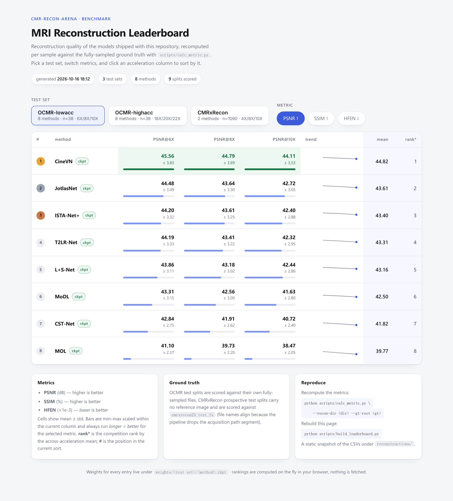

<div align="center">

# cmr-recon-arena

**A fully reproducible leaderboard for cine MRI reconstruction**

8 architectures · 21 public checkpoints · OCMR & CMRxRecon · one command rebuilds everything

[](https://yhao-zhang.top/cmr-recon-arena/leaderboard) [](https://huggingface.co/yhao-z/cmr-recon-arena) [](#-for-coding-agents) [](requirements.txt) [](requirements.txt) [](LICENSE)

[**Live leaderboard**](https://yhao-zhang.top/cmr-recon-arena/leaderboard) · [**Checkpoints**](https://huggingface.co/yhao-z/cmr-recon-arena) · [**Add your model**](#-contributing)

</div>

---

Architecture papers live and die by comparison — yet most comparison code and checkpoints never ship. This repo takes the opposite position: **every number is regenerable from a released checkpoint on public data, with the same pipeline for every model.** No hidden weights, no "code available upon request", no table you have to take on faith.

<p align="center">
  
</p>

## ✨ Highlights

<table>
<tr>
<td width="50%">

**🔁 Reproducible by construction**
All 21 checkpoints (8 architectures × 2 OCMR test sets, 5 on CMRxRecon) are on [Hugging Face](https://huggingface.co/yhao-z/cmr-recon-arena); the benchmark script fetches any that are missing locally on first run.

</td>
<td width="50%">

**⚙️ One pipeline for everyone**
The same data transforms, the same test loop, the same metrics for every model. A new model joins by dropping in one config and one Lightning module — it cannot get a friendlier evaluation than the incumbents.

</td>
</tr>
<tr>
<td>

**🚀 One command rebuilds all**
`scripts/run_benchmark.py` runs every missing test, scores every split, and regenerates the page. Interrupt it freely — it resumes and never overwrites existing results.

</td>
<td>

**🤖 Agent-ready**
The repo ships its own [AI-agent skill](#-for-coding-agents): point Claude Code, Hermes Agent or any compatible tool at `skills/` and it can set up the environment, run the benchmark, and onboard a new model by itself.

</td>
</tr>
</table>

## 🏆 Leaderboard snapshot

PSNR (dB) on **OCMR low acceleration** (mean over 38 test samples per split):

| Method     | @6X       | @8X       | @10X      |
| ---------- | --------- | --------- | --------- |
| **CineVN** | **45.56** | **44.79** | **44.11** |
| JotlasNet  | 44.48     | 43.64     | 42.72     |
| ISTA-Net+  | 44.20     | 43.61     | 42.40     |
| T2LR-Net   | 44.19     | 43.41     | 42.32     |
| L+S-Net    | 43.86     | 43.18     | 42.44     |
| MoDL       | 43.31     | 42.56     | 41.63     |
| CST-Net    | 42.84     | 41.91     | 40.72     |
| MOL        | 41.10     | 39.73     | 38.47     |

SSIM and HFEN, the other two test sets, standard deviations and per-split breakdowns are all in the [live leaderboard](https://yhao-zhang.top/cmr-recon-arena/leaderboard) / the `reconstructions/` CSVs.

## 🧪 Test sets & metrics

| Group          | Splits              | Accelerations | n / split | Reference (GT)          |
| -------------- | ------------------- | ------------- | --------- | ----------------------- |
| `OCMR-lowacc`  | `test_gro_06/08/10` | 6X, 8X, 10X   | 38        | own fully-sampled files |
| `OCMR-highacc` | `test_gro_18/20/22` | 18X, 20X, 22X | 38        | own fully-sampled files |
| `CMRxRecon`    | `test_pse_04/08/10` | 4X, 8X, 10X   | 1090      | `cmrxrecon23_test_fs`*  |

\* The prospective test splits carry only `kspace`+`mask` (no reference image); they are scored against the fully-sampled set, whose file names align because the preprocessing drops the acquisition path segment.

Metrics: **PSNR** (dB, ↑), **SSIM** (%, ↑), **HFEN** (×1e-3, ↓). All three are computed per sample against `reconstruction_weighted`, then aggregated as mean ± std.

## 🧬 Model zoo

| Method    | Config                           | Weights               | Reference                                                                                           |
| --------- | -------------------------------- | --------------------- | --------------------------------------------------------------------------------------------------- |
| CineVN    | `configs/model/cinevn.yaml`      | both OCMR + CMRxRecon | [marcvornehm/CineVN](https://github.com/marcvornehm/CineVN)                                         |
| CST-Net   | `configs/model/CSTNet.yaml`      | both OCMR             | [XWangBin/CST-Net](https://github.com/XWangBin/CST-Net)                                             |
| ISTA-Net+ | `configs/model/istanetplus.yaml` | both OCMR + CMRxRecon | [jianzhangcs/ISTA-Net-PyTorch](https://github.com/jianzhangcs/ISTA-Net-PyTorch)                     |
| JotlasNet | `configs/model/jotlasnet.yaml`   | both OCMR + CMRxRecon | [yhao-z/JotlasNet](https://github.com/yhao-z/JotlasNet)                                             |
| L+S-Net   | `configs/model/l+s-net.yaml`     | both OCMR + CMRxRecon | [wenqihuang/LS-Net-Dynamic-MRI](https://github.com/wenqihuang/LS-Net-Dynamic-MRI)                   |
| MoDL      | `configs/model/modl.yaml`        | both OCMR             | [bo-10000/MoDL_PyTorch](https://github.com/bo-10000/MoDL_PyTorch)                                   |
| MOL       | `configs/model/mol.yaml`         | both OCMR             | [migroup-mit/Monotone-Operator-Learning](https://github.com/migroup-mit/Monotone-Operator-Learning) |
| T2LR-Net  | `configs/model/t2lrnet.yaml`     | both OCMR + CMRxRecon | [yhao-z/T2LR-Net](https://github.com/yhao-z/T2LR-Net)                                               |

## 🚀 Quick start

```bash
git clone https://github.com/yhao-z/cmr-recon-arena.git && cd cmr-recon-arena
pip install -r requirements.txt
```

**1. Weights.** `weights/` is gitignored — on first run `run_benchmark.py` lists the [Hugging Face repo](https://huggingface.co/yhao-z/cmr-recon-arena) (`<group>/<method>.ckpt`) and fetches whatever is missing locally (direct in most regions; falls back to `hf-mirror.com` automatically, or set `HF_ENDPOINT`). To pull them by hand:

```bash
hf download yhao-z/cmr-recon-arena --local-dir weights
```

**2. Datasets.** Obtain OCMR and CMRxRecon2023 from their official releases, build the training format with `preprocessing/run_ocmr.py` and `preprocessing/run_cmrxrecon23.py`, and point the data root at the result:

```bash
export YHAO_DATA=/path/to/datasets      # configs resolve data_path against it
```

**3. Everything, in one command:**

```bash
python scripts/run_benchmark.py --dry-run   # show which runs are missing
python scripts/run_benchmark.py             # tests -> metrics -> summaries -> page
```

This ends with a fresh `leaderboard.html`. Re-running only redoes missing work; symlinked results are treated as read-only.

**4. Or one test at a time:**

```bash
python main.py test \
  --config configs/data/ocmr_test_lowacc.yaml \
  --config configs/model/mol.yaml \
  --ckpt_path weights/OCMR-lowacc/MOL.ckpt
```

Reconstructions land in `reconstructions/<test set>/<split>/<Method>_reconstructions.h5` (keyed by source file name). Metrics and the page:

```bash
python scripts/calc_metric.py \
  --recon-dir reconstructions/OCMR-lowacc/ocmr_test_gro_06 \
  --gt-root $YHAO_DATA/OCMR/processed_ocmr/ocmr_test_gro_06
python scripts/calc_metric.py --recon-dir reconstructions/OCMR-lowacc  # summary table
python scripts/build_leaderboard.py                                    # leaderboard.html
```

## 🤖 For coding agents

This repository ships its own **agent skill** — `skills/cmr-recon-arena/` — a self-contained operating manual in the standard `SKILL.md` format that coding agents (Claude Code, Hermes Agent, and anything compatible) can load in one copy step.

It encodes what a newcomer would otherwise learn the hard way:

- **First-run protocol** — the agent asks six setup questions once (code path, data root, environment, GPUs, tracking, run policy), writes the answers to `references/environment.md`, and never asks again.
- **Task routing** — dataset building, training, testing, the metric rules (including the CMRxRecon ground-truth pairing), the leaderboard rebuild.
- **Add-a-model walkthrough** — `references/NEW_MODEL.md`: the exact three files to create, the `MriModule` wrapper contract, and the verification commands to run before training.
- **Pitfalls** — mandatory `--ckpt_path`, config merge order, mask selection, cache invalidation, and more.

Install it into an agent (one directory copy):

```bash
# Claude Code (project scope)
cp -r skills/cmr-recon-arena .claude/skills/

# Hermes Agent
cp -r skills/cmr-recon-arena ~/.hermes/profiles/<profile>/skills/projects/

# anything else: point your agent at skills/cmr-recon-arena/SKILL.md —
# it will read references/ on demand.
```

No agent? Everything the skill knows is plain Markdown — humans are equally welcome to read it directly.

## 🤝 Contributing

**New models are the life of a leaderboard — PRs welcome!** If you have a reconstruction network (published, or in preparation), putting it on the arena takes three files and one command, and it is evaluated under exactly the same pipeline as every incumbent.

1. **Fork and read** [`skills/cmr-recon-arena/references/NEW_MODEL.md`](skills/cmr-recon-arena/references/NEW_MODEL.md) — or point your coding agent at it; the whole procedure is encoded in the repo skill.
2. **Add three files:**
   - `models/<your_model>.py` — a plain `nn.Module`
   - `pl_modules/<your_model>_module.py` — a thin Lightning wrapper around `MriModule`
   - `configs/model/<your_model>.yaml` — trainer + init args
3. **Run the missing benchmark** (`python scripts/run_benchmark.py`) and open a PR with your results — plus the checkpoint (link, or Hugging Face upload) so your row stays reproducible.

Also welcome: new test sets and splits, metric fixes, documentation. The one rule: **don't touch the shared pipeline** — identical treatment for every model is the whole point.

[](#-contributing)

## 🗂️ Repository layout

```
configs/            data + model YAMLs; configs/test.yaml is the test template
helpers/            utilities (losses, metrics, MRI operators) + data/ subpackage (dataset, transforms, masks, samplers)
models/             the architectures, one module each
pl_modules/         Lightning modules (train/val/test logic)
preprocessing/      run_*.py interfaces; kernels under preprocessing/core/
scripts/            run_benchmark.py · calc_metric.py · build_leaderboard.py
skills/cmr-recon-arena/       agent-facing reproducibility guide (see above)
weights/            <test set>/<Method>.ckpt
reconstructions/    <test set>/<split>/… results + metrics CSVs (gitignored)
leaderboard.html    generated, self-contained, committed
```

Interfaces live at the top level of each directory; kernels sit one level deeper, so the entry point of any workflow is visible without opening internals.

## 📄 Citation

To be added together with the associated publication.

## 📜 License

[MIT](LICENSE) — the same license the checkpoints are published under on Hugging Face.
